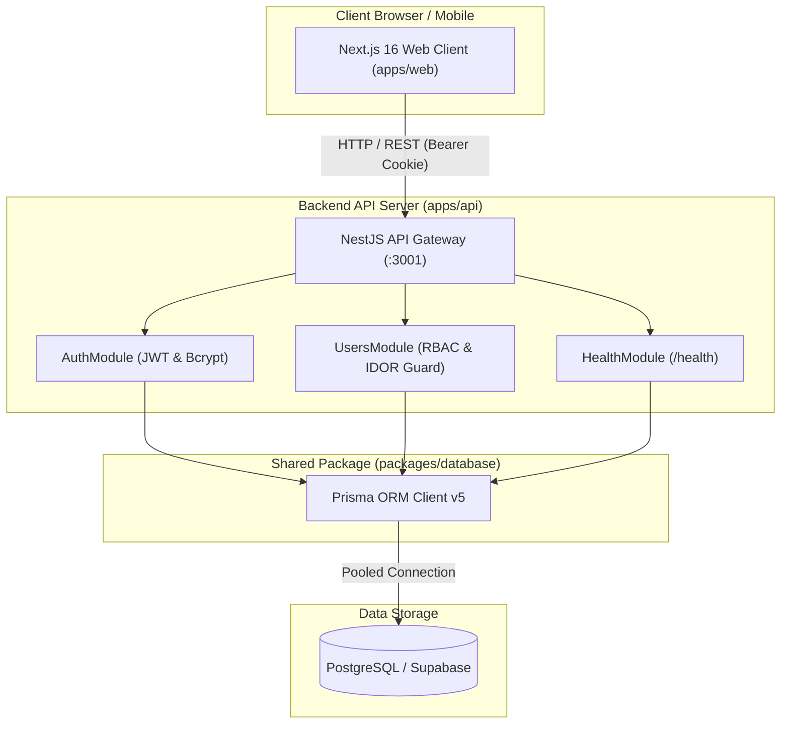
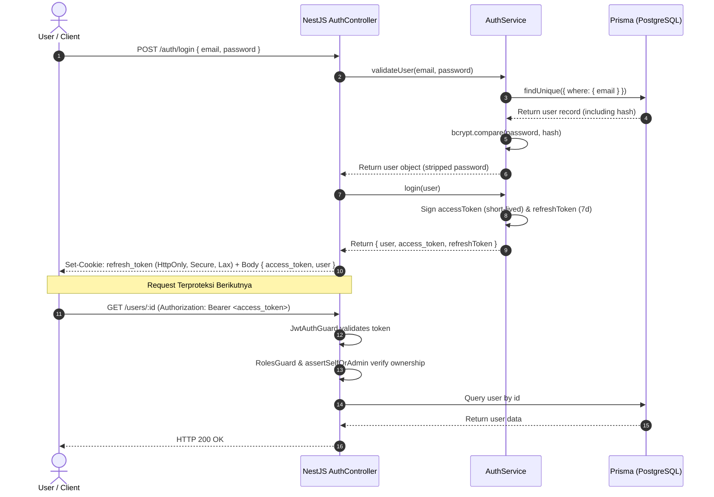
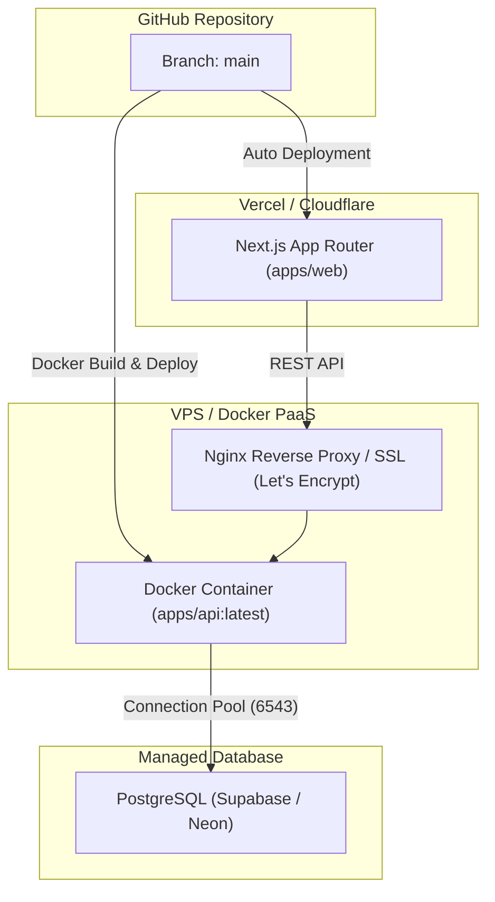

# 🏛️ Maincore — Arsitektur Sistem Menyeluruh

> **Stack Plus Studio Core Engine V1.0**  
> Fondasi full-stack monorepo kelas produksi untuk mempercepat inisiasi proyek web enterprise.

Dokumen ini menjelaskan rancangan arsitektur, topologi monorepo, aliran data, lapisan keamanan, sistem pengujian, dan alur CI/CD pada Maincore secara detail dan komprehensif.

---

## 1. Topologi Sistem & Monorepo

Maincore dibangun di atas arsitektur **Monorepo** yang dikelola menggunakan **pnpm workspaces** dan diorkestrasi oleh **Turborepo**.



### Struktur Monorepo Workspace

```text
stackplus-core/
├── apps/
│   ├── api/                    # Backend application (NestJS 11)
│   │   ├── src/
│   │   │   ├── auth/           # Otentikasi, JWT strategy, Guards, Roles
│   │   │   ├── users/          # Blueprint CRUD, DTO, IDOR assertions
│   │   │   ├── health/         # Endpoint health check (/health)
│   │   │   ├── prisma/         # PrismaService singleton
│   │   │   ├── app.module.ts   # Root module (Config & Throttler global)
│   │   │   └── main.ts         # Entry point (Helmet, CORS, ValidationPipe)
│   │   ├── test/               # E2E test suites & Test safety guard
│   │   └── Dockerfile          # Production multi-stage Docker build
│   │
│   └── web/                    # Frontend application (Next.js 16 App Router)
│       ├── src/
│       │   ├── app/            # App Router pages & route groups
│       │   │   ├── dashboard/  # Dashboard & User management CRUD UI
│       │   │   └── layout.tsx  # Root layout & font setup
│       │   ├── components/     # UI design system & components
│       │   ├── lib/            # Axios instance dengan cookie interceptor
│       │   └── proxy.ts        # Route protection proxy/middleware
│       └── e2e/                # Playwright E2E smoke tests
│
├── packages/
│   └── database/               # Shared database package
│       ├── prisma/
│       │   ├── schema.prisma   # Skema Prisma tunggal (User, dsb)
│       │   └── migrations/     # Riwayat migrasi database SQL
│       └── index.ts            # Prisma client exports
│
├── perf/                       # Performance testing suite (k6)
│   └── k6/
│       ├── scenarios/          # Smoke, Load, Stress, Spike, Soak tests
│       └── lib/                # Config & production safety guards
│
├── docs/                       # Dokumentasi teknik & SOP
│   ├── architecture.md         # Dokumen ini
│   ├── ui.md                   # UI design system & visual identity
│   ├── newproject.md           # SOP memulai proyek baru dari core
│   ├── handover.md             # Protokol serah-terima pengerjaan
│   ├── testing-runbook.md      # Panduan eksekusi testing
│   ├── perf-testing.md         # Metodologi performance testing k6
│   ├── security-scanning.md    # Panduan scanning Trivy & Gitleaks
│   └── ci-cd.md                # Dokumentasi pipeline CI/CD GitHub Actions
│
├── .github/workflows/          # Otomasi CI/CD GitHub Actions
│   ├── ci.yml                  # Quality Gate (Lint, Test, Typecheck, Build)
│   └── security.yml            # Security Scan (Gitleaks, Audit, Trivy)
│
├── .gitleaks.toml              # Allowlist konfigurasi Gitleaks
├── .trivyignore                # Rule ignore Trivy scanner
├── turbo.json                  # Turborepo task pipeline configuration
└── pnpm-workspace.yaml         # Workspace package boundaries
```

---

## 2. Lapisan Frontend (`apps/web`)

Aplikasi web dibangun menggunakan **Next.js 16** dengan **App Router** dan Tailwind CSS yang terikat pada Design System resmi Stack Plus Studio.

### Prinsip Desain & Aliran Data Frontend
1. **HTTP Client Terpusat (`@/lib/axios`):**
   - Menggunakan instance Axios tunggal yang otomatis membaca `NEXT_PUBLIC_API_URL`.
   - Mengaktifkan `withCredentials: true` sehingga cookie HTTP-Only (refresh token) dan token autentikasi terkirim otomatis pada setiap request ke API.
   - Melarang keras penggunaan `fetch()` bawaan browser secara langsung agar header dan error-handling tetap seragam.
2. **Proteksi Rute (`proxy.ts` / Middleware):**
   - Menjaga rute dashboard agar hanya dapat diakses oleh user yang memiliki session aktif.
   - Mengarahkan user yang belum login kembali ke halaman login.
3. **Route Groups Berdasarkan Entitas/Role:**
   - Halaman dashboard dipisahkan secara modular, misalnya `app/dashboard/users/` atau `app/(dashboard)/admin/...`.
4. **UI Feedback:**
   - Menghindari `alert()` bawaan browser.
   - Selalu menggunakan `react-hot-toast` (`toast.success()`, `toast.error()`) untuk memberikan status aksi pengguna.

---

## 3. Lapisan Backend (`apps/api`)

Backend API dibangun dengan **NestJS 11** yang mengedepankan modularitas tinggi, enkapsulasi, dan standar keamanan berlapis (*defense-in-depth*).

### Modul Inti Backend

| Modul | Tanggung Jawab Utama |
|---|---|
| **`AppModule`** | Root orchestrator. Mengonfigurasi `ConfigModule` global (validasi startup environment) dan `ThrottlerModule` global. |
| **`AuthModule`** | Menangani registrasi token, verifikasi hash bcrypt, strategi `PassportJwt`, serta penandatanganan Access & Refresh Token via `ConfigService`. |
| **`UsersModule`** | Blueprint standar CRUD. Menerapkan kontrol akses berbasis peran (RBAC), pencegahan IDOR, dan paginasi database. |
| **`HealthModule`** | Endpoint ketersediaan sistem `GET /health` untuk liveness/readiness probe Docker & load balancer. |
| **`PrismaModule`** | Singleton wrapper untuk Prisma Client dengan lifecycle hook `onModuleInit` dan graceful shutdown. |

### Lapisan Keamanan Backend (Security Defenses)

```mermaid
flowchart LR
    REQ["Incoming HTTP Request"] --> HELMET["Helmet (HTTP Security Headers)"]
    HELMET --> CORS["CORS (Whitelist Origin)"]
    CORS --> THROTTLE["ThrottlerGuard (Rate Limiter: 100/min & Login: 5/min)"]
    THROTTLE --> PIPE["ValidationPipe (Whitelist & ForbidNonWhitelisted)"]
    PIPE --> JWT["JwtAuthGuard (Passport JWT Validation)"]
    JWT --> ROLES["RolesGuard (@Roles('ADMIN'))"]
    ROLES --> IDOR["assertSelfOrAdmin (IDOR & Ownership Check)"]
    IDOR --> CONTROLLER["Controller Handler & Service Execution"]
```



1. **Helmet HTTP Headers:** Melindungi aplikasi dari serangan berbasis browser (XSS, Clickjacking, MIME-sniffing, CSP).
2. **Strict CORS:** Hanya mengizinkan request dari URL frontend terdaftar (`FRONTEND_URL` / `http://localhost:3000`) dengan izin kredensial.
3. **Rate Limiting (Brute-Force Protection):**
   - Global rate limit: 100 request/menit per IP.
   - Khusus login (`POST /auth/login`): Maksimal 5 request/menit untuk mencegah brute-force password.
4. **Mass-Assignment & Input Sanitization (`ValidationPipe`):**
   - `whitelist: true`: Menghapus semua property yang tidak terdefinisi pada DTO.
   - `forbidNonWhitelisted: true`: Langsung menolak request (HTTP 400) jika terdapat payload asing/tak dikenal.
   - `transform: true`: Mengonversi tipe payload secara otomatis ke tipe DTO target.
5. **No Hardcoded Secrets (C-2 Fix):**
   - `JWT_SECRET` dan `JWT_REFRESH_SECRET` dibaca wajib melalui `ConfigService.getOrThrow()`. Aplikasi gagal booting jika variabel ini tidak diset di environment.
6. **IDOR & Role-Based Access Control (RBAC):**
   - `RolesGuard` dan decorator `@Roles('ADMIN')` membatasi endpoint sensitif.
   - Helper `assertSelfOrAdmin(targetId, currentUser)` memastikan user non-admin hanya dapat membaca dan mengubah data miliknya sendiri.

---

## 4. Lapisan Database (`packages/database`)

Database menggunakan **PostgreSQL** yang diakses melalui **Prisma ORM (v5.22.0)**.

### Karakteristik Skema Database:
- **Default Role:** Model `User` memiliki nilai default `role: "USER"` (mencegah eskalasi hak akses otomatis ke `ADMIN`).
- **Connection Management:** Mendukung `DATABASE_URL` untuk pooled connection (Port 6543 / PgBouncer pada Supabase) dan `DIRECT_URL` (Port 5432) untuk eksekusi migrasi DDL.
- **Paginasi Terstandar (M-2 Fix):** Semua query multi-row (`findAll`) wajib menggunakan klausa `take` dan `skip` dengan batas maksimal (default 20, max 100) serta mengembalikan metadata paginasi (`total`, `page`, `limit`, `totalPages`).

---

## 5. Aliran Otentikasi & Autorisasi (Auth Flow)



---

## 6. Arsitektur Pengujian & Quality Gates

Kualitas Maincore dijaga secara otomatis melalui beberapa lapisan pengujian (*testing pyramid*):

```text
               ▲
              / \     k6 Performance Tests (Smoke, Load, Stress, Soak)
             /---\    
            /     \   Frontend E2E Smoke Tests (Playwright)
           /-------\  
          /         \ API E2E Security Tests (Supertest + Mocked DB)
         /-----------\
        /             \ Unit & Regression Tests (Jest, Coverage > 70%)
       /---------------\
```

### 1. Unit & Regression Tests (`apps/api`)
- Menguji business logic, service, controller, guard, dan DTO validation.
- Dilengkapi **`test-safety.guard.ts`**: Menjamin tes otomatis langsung *abort* jika `DATABASE_URL` terdeteksi mengarah ke cloud/Supabase produksi.
- Threshold cakupan kode (coverage gate) diatur minimal **70%** untuk branches, functions, lines, dan statements.

### 2. API E2E Integration Tests (`apps/api/test/`)
- Menguji seluruh middleware: proteksi Helmet, validasi status 400 Bad Request, payload SQL injection injection safety, dan pemblokiran route unauthenticated (HTTP 401).

### 3. Frontend Smoke Tests (`apps/web/e2e/`)
- Menggunakan Playwright untuk memvalidasi landing page, komponen dashboard, dan aliran navigasi.

### 4. Performance & Load Testing (`perf/k6/`)
- Menampung skenario uji beban: `smoke.js`, `load.js`, `stress.js`, `spike.js`, dan `soak.js`.
- Dilengkapi safety check (`perf/k6/lib/safety.js`) yang memblokir penembakan beban ke domain produksi tanpa izin eksplisit.

---

## 7. CI/CD & Security Automation Pipeline

Dua workflow GitHub Actions mengawal setiap commit dan Pull Request ke branch `main`:

### 1. `CI Quality Gate` (`.github/workflows/ci.yml`)
1. **Runner Setup:** Node.js 20, pnpm v9, PostgreSQL 16 service container.
2. **Prisma Generation & Migration:** Menjalankan `pnpm db:generate` dan `prisma migrate deploy` ke test DB lokal.
3. **Typecheck:** `pnpm typecheck` (verifikasi integritas tipe TypeScript di seluruh workspace).
4. **Linting:** `pnpm lint` (ESLint tanpa `--fix` untuk memastikan kode memenuhi standar).
5. **Testing & Coverage:** `pnpm test:cov` (verifikasi 39 unit test & threshold coverage > 70%).
6. **API E2E:** `pnpm --filter api test:e2e` (uji penetrasi dan integrasi API).
7. **Production Build:** `pnpm build` (memvalidasi Next.js App Router dan NestJS build).
8. **Docker Build Validation:** Menguji build multi-stage Docker image API.

### 2. `Security Scan` (`.github/workflows/security.yml`)
1. **Gitleaks (v3):** Mendeteksi potensi kebocoran API key, private key, dan credentials pada commit git history.
2. **pnpm audit:** Memeriksa CVE pada dependensi produksi.
3. **Trivy Filesystem Scan (v0.36.0):** Memindai kerentanan library dan miskonfigurasi.
4. **Trivy Container Scan (v0.36.0):** Memindai CVE pada image Docker backend.

---

## 8. Panduan Deployment



- **Frontend (`apps/web`):** Deploy langsung ke Vercel dengan Root Directory diatur ke `apps/web` atau di root dengan framework preset Next.js.
- **Backend (`apps/api`):** Deploy via Dockerfile yang sudah di-hardening (menjalankan aplikasi sebagai non-root user `node` dan dilengkapi probe `HEALTHCHECK`).
- **Database:** PostgreSQL terkelola (Supabase / Neon) dengan koneksi SSL aktif.

